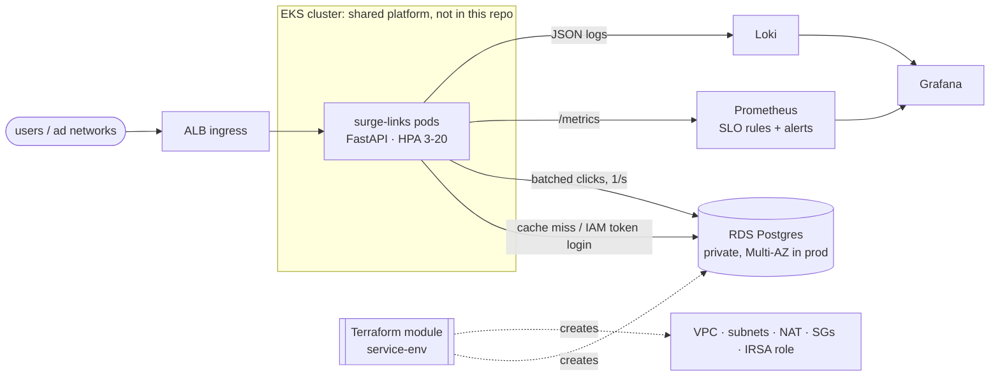

# surge-links

A short-link service for marketing campaigns, built to survive the traffic spike when an ad goes
live. It is also a small platform blueprint: a reusable Terraform module, a Helm chart and an
observability setup that another service can copy.



In this repo: the service, its Terraform module, the Helm chart, monitoring, load and DR tests.
Not in this repo: the EKS cluster, the ingress controller and External Secrets, which are
shared per cluster rather than per service.

## What is in here

| Area | Where | Highlights |
|---|---|---|
| Backend | [`app/`](app) | FastAPI, async SQLAlchemy, in-process cache with negative caching and single-flight, clicks batched into one `UPDATE ... FROM unnest()` per second |
| Database | [`migrations/`](migrations) | Alembic; partial index on campaign; hourly pre-aggregated click counters |
| Infrastructure | [`infra/terraform`](infra/terraform) | own module `service-env` (VPC, RDS, security groups, IRSA, RDS IAM auth), env-aware safe defaults, input validation, `terraform test` with a mocked provider; dev/prod in separate AWS accounts; day-0 bootstrap with state bucket and GitHub OIDC (no static keys); `terraform plan` posted on PRs |
| Kubernetes | [`deploy/helm`](deploy/helm/surge-links) | HPA tuned for spikes, PDB, migrations as a pre-upgrade hook, IAM login to Postgres, security groups for pods, graceful shutdown, non-root read-only container |
| Observability | [`observability/`](observability) | RED metrics, SLO recording rules, multi-window burn-rate alerts, Grafana dashboard, Loki logs |
| Load and DR | [`load/`](load), [`scripts/`](scripts) | k6 spike (10x in 10 s), DR drill with measured RTO |
| CI | [`.github/workflows`](.github/workflows/ci.yml) | ruff, pytest on real Postgres, terraform fmt/validate/test/tflint/trivy, helm lint + kubeconform, e2e with k6 and the DR drill |

Docs: [SLOs](docs/slo.md) · [capacity and connection budget](docs/capacity.md) ·
[runbook](docs/runbook.md) · [launch a new service in 3 steps](docs/golden-path.md) ·
[trade-offs](docs/tradeoffs.md)

## Run it locally

```bash
make up      # app :8000/docs · grafana :3000 · prometheus :9090
make smoke   # short k6 run
make load    # the spike scenario, results in load/results/summary.json
make dr      # backup -> drop database -> restore -> verify -> RTO
make down
```

API:

```bash
curl -s -X POST localhost:8000/api/v1/links \
  -H 'content-type: application/json' \
  -d '{"target_url": "https://example.com/offer", "campaign": "black_friday"}'
curl -si localhost:8000/<code>                # 307 to the target
curl -s localhost:8000/api/v1/links/<code>/stats
```

## Status: what has actually been run

Numbers below come from CI (a shared GitHub Actions runner, app limited to 1 CPU): they show the
design holds under a spike, not what production hardware would do.

- [x] **Tests on Postgres 17** in CI
- [x] **k6 spike**, 50 → 2 000 requests/s in 10 s, held for 60 s: **156 770 redirects, 0 errors,
      p99 1.06 ms, p95 0.82 ms** (SLO: p99 < 100 ms, errors < 0.1%)
- [x] **k6 smoke**: 98 662 redirects, 0 errors, p99 2.05 ms
- [x] **DR drill**: backup → drop database → restore → data identical, **RTO 3 s** on a tiny
      dataset (RDS point-in-time restore takes minutes; see the runbook)
- [x] Terraform: `fmt`, `validate`, module tests with a mocked provider, tflint, trivy
- [ ] Grafana dashboard screenshot from a local run
- **Terraform has never been applied to a real AWS account.** It is validated and tested
  against a mocked provider only, so no money was spent. Account IDs in `envs/` are placeholders,
  and `terraform-plan.yml` stays disabled until real accounts are configured.

## What I would do differently with a real AWS account

- Apply `bootstrap/aws-account` first, then run `terraform plan` on PRs for real and apply from
  the protected environment only.
- Put RDS Proxy in front of Postgres before raising `maxReplicas` above ~30 (docs/capacity.md).
- Send clicks to a queue instead of Postgres once traffic grows past what batched UPDATEs handle.
- Replace the wildcard EC2/RDS actions in the deployer role with a permissions boundary.
- Run the DR drill against a real RDS point-in-time restore and record the actual RTO.

## Author

Alibek Kanatbay
