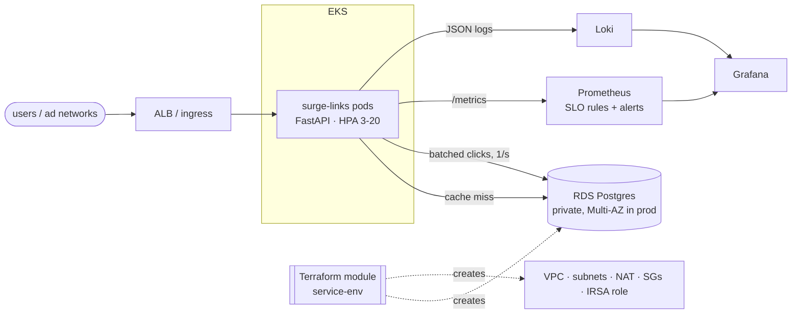

# surge-links

A short-link service for marketing campaigns, built to survive the traffic spike when an ad goes
live. It is also a small platform blueprint: a reusable Terraform module, a Helm chart and an
observability setup that another service can copy.



## What is in here

| Area | Where | Highlights |
|---|---|---|
| Backend | [`app/`](app) | FastAPI, async SQLAlchemy, in-process cache with negative caching and single-flight, clicks batched into one `UPDATE ... FROM unnest()` per second |
| Database | [`migrations/`](migrations) | Alembic; partial index on campaign; hourly pre-aggregated click counters |
| Infrastructure | [`infra/terraform`](infra/terraform) | own module `service-env` (VPC, RDS, security groups, IRSA), env-aware safe defaults, input validation, `terraform test` with a mocked provider; dev/prod in separate AWS accounts; GitHub OIDC role (no static keys) |
| Kubernetes | [`deploy/helm`](deploy/helm/surge-links) | HPA tuned for spikes, migrations as a pre-upgrade hook, graceful shutdown, non-root read-only container |
| Observability | [`observability/`](observability) | RED metrics, SLO recording rules, multi-window burn-rate alerts, Grafana dashboard, Loki logs |
| Load and DR | [`load/`](load), [`scripts/`](scripts) | k6 spike (10x in 10 s), DR drill with measured RTO |
| CI | [`.github/workflows`](.github/workflows/ci.yml) | ruff, pytest on real Postgres, terraform fmt/validate/test/tflint/trivy, helm lint + kubeconform, e2e with k6 and the DR drill |

Docs: [SLOs](docs/slo.md) · [capacity and connection budget](docs/capacity.md) ·
[runbook](docs/runbook.md) · [launch a new service in 3 steps](docs/golden-path.md) ·
[trade-offs](docs/tradeoffs.md)

## Run it locally

```bash
make up      # app :8000/docs · grafana :3000 · prometheus :9090
make smoke   # short k6 run
make load    # the spike scenario, results in load/results/summary.json
make dr      # backup -> drop database -> restore -> verify -> RTO
make down
```

API:

```bash
curl -s -X POST localhost:8000/api/v1/links \
  -H 'content-type: application/json' \
  -d '{"target_url": "https://example.com/offer", "campaign": "black_friday"}'
curl -si localhost:8000/<code>                # 307 to the target
curl -s localhost:8000/api/v1/links/<code>/stats
```

## Status: what has actually been run

- [ ] tests on Postgres in CI
- [ ] terraform module tests and validation in CI
- [ ] k6 spike on the local stack (results and a dashboard screenshot will be added here)
- [ ] DR drill
- **Terraform has never been applied to a real AWS account.** It is validated and tested
  against a mocked provider only, so no money was spent. Account IDs in `envs/` are placeholders.

## Author

Alibek Kanatbay
